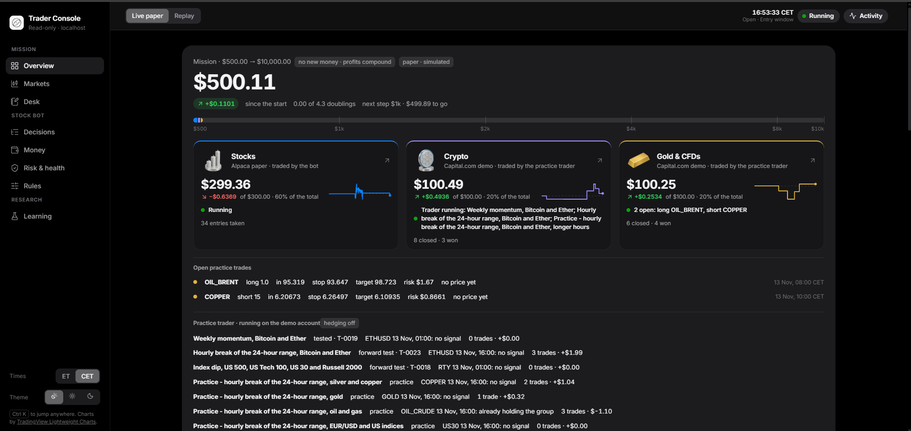
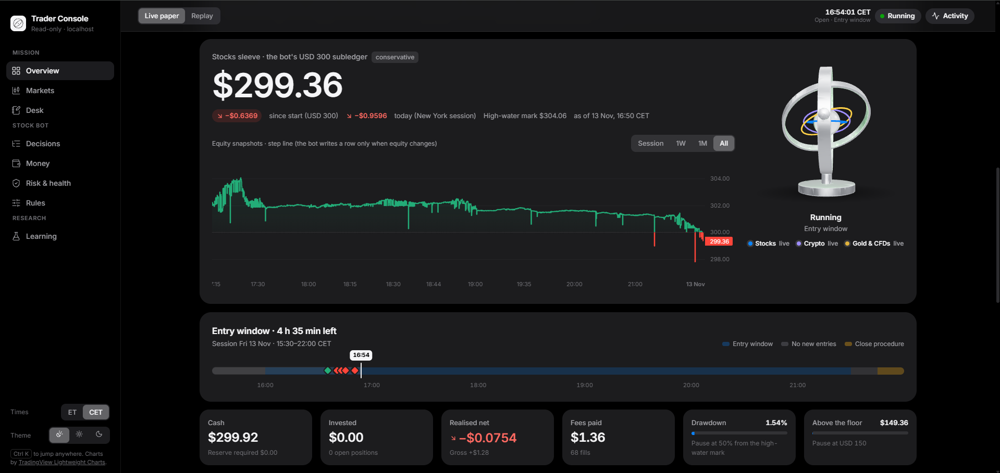
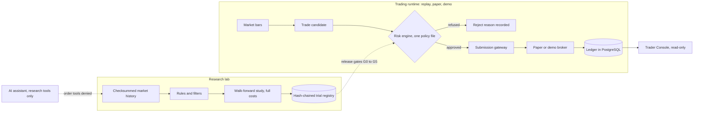

<p align="center">
  
</p>

<h1 align="center">AI Stock Trader</h1>

<p align="center">
  <b>An automated trading system that has to prove an edge before it may touch real money.</b><br>
  Stocks, crypto and CFDs · replay and paper first · every decision recorded · live trading locked in code
</p>

<p align="center">
  
  
  
  
  
  
  
  <a href="LICENSE"></a>
</p>

<p align="center">
  <a href="#what-it-is">What it is</a> ·
  <a href="#why-it-is-different">Why it is different</a> ·
  <a href="#honest-results-so-far">Results</a> ·
  <a href="#how-it-works">How it works</a> ·
  <a href="#timeline">Timeline</a> ·
  <a href="#run-it-yourself">Run it yourself</a> ·
  <a href="#documentation">Docs</a>
</p>

---

## What it is

AI Stock Trader is an evidence-gated trading system. It researches trading rules on real market data, trades them on paper and demo accounts, and records every decision it makes, including the ones it refuses.

It started from one question in the [original brief](#appendix-the-original-brief): can a small account be traded profitably *after every cost*? Most projects answer that with a backtest chart. This one answers it with machinery: a research log that cannot be quietly rewritten, release gates that must pass in order, and a risk engine that nothing can go around.

Today it runs three books, all on paper or demo money:

<table>
  <tr>
    <td align="center" width="33%">
      <br>
      <b>Stocks</b><br>
      <sub>20 large US stocks on an Alpaca paper account, traded by the bot every five minutes</sub>
    </td>
    <td align="center" width="33%">
      <br>
      <b>Crypto</b><br>
      <sub>Bitcoin and Ether on a Capital.com demo account, traded by the practice trader</sub>
    </td>
    <td align="center" width="33%">
      <br>
      <b>Gold and CFDs</b><br>
      <sub>Gold, silver, oil, indices and EUR/USD on the same demo account</sub>
    </td>
  </tr>
</table>

<p align="center">
  
  <br>
  <sub>The Trader Console: the mission, the three books, open practice trades and what each rule last decided.</sub>
</p>

<p align="center">
  
  <br>
  <sub>The stocks book: equity, the entry window of the session, fees, drawdown and the distance to the pause floor.</sub>
</p>

> [!NOTE]
> Every balance in these screenshots is **paper or demo money**. The console is a read-only page on `127.0.0.1`; it holds no keys and cannot place a trade.

## Why it is different

Most trading bots start by placing orders. This one starts by asking for proof.

What is new here is not a secret strategy. It is the order of operations: **proof first, money second**, with code that enforces that order and tests that fail if anyone tries to change it.

<table>
  <tr>
    <td width="50%" valign="top" align="center">
      <br>
      <b>Live trading is locked in code</b><br><br>
      <sub>The <code>trader live</code> command always refuses. The list of certified live adapters is an empty set, every shipped config has <code>live_enabled: false</code>, the Alpaca adapter rejects live keys, and the Capital.com host is hard-coded to the demo server. Unlocking it takes passed gates, a signed promotion manifest and a deliberate owner step.<br><br>
      <a href="src/trader/runtime/live_guard.py">live_guard.py</a> · <a href="configs/policy/base.yaml">policy</a></sub>
    </td>
    <td width="50%" valign="top" align="center">
      <br>
      <b>Evidence gates, not optimism</b><br><br>
      <sub>Six release gates, G0 to G5, stand between an idea and real money. Gate G2 alone asks for at least 100 out-of-sample trades over 120 sessions, after every cost, with a positive lower bound that accounts for how many rules were tried. A model filter must also beat refusing trades at random.<br><br>
      <a href="docs/specs/risk_and_validation.md">risk_and_validation.md</a> · <a href="docs/project_status.md">gate status</a></sub>
    </td>
  </tr>
  <tr>
    <td width="50%" valign="top" align="center">
      <br>
      <b>A research log that cannot be quietly rewritten</b><br><br>
      <sub>Every trial is registered <i>before</i> it runs, in a hash-chained file where each record contains the hash of the one before. The trial budget is fixed (26), so nobody can try a thousand variants and report the lucky one. Failures stay in the log next to the successes.<br><br>
      <a href="src/trader/research/registry.py">registry.py</a> · <a href="research/experiment_registry.jsonl">the log</a></sub>
    </td>
    <td width="50%" valign="top" align="center">
      <br>
      <b>An AI assistant that can research but cannot trade</b><br><br>
      <sub>The assistant gets market-data tools; 142 tools that could trade, move money or touch an account are denied, and a guard runs before every demo order preview. No language model sits in the trading loop: a test fails the build if an LLM library enters the runtime dependencies. Models may veto a trade, never size one.<br><br>
      <a href=".claude/settings.json">deny list</a> · <a href="tests/test_boundaries.py">boundary tests</a></sub>
    </td>
  </tr>
</table>

More of the same idea, all in the code:

- **One risk engine, one policy file.** Sizes and permissions come from a deterministic engine using exact decimals. The real-money policy risks 0.25% per trade, allows two open positions, and pauses at 1% daily loss, 2.5% weekly loss or a 10% drawdown ([`configs/policy/base.yaml`](configs/policy/base.yaml), [`src/trader/risk/engine.py`](src/trader/risk/engine.py)).
- **Every candidate ends in a trade or a named reason.** There are 18 reject reasons, and "cash, no trade" is a legitimate outcome ([`src/trader/domain/candidates.py`](src/trader/domain/candidates.py)).
- **Pauses survive restarts.** 20 pause causes are persisted. A pause blocks new entries only; exits always continue ([`src/trader/ops/pause.py`](src/trader/ops/pause.py)).
- **Boundaries are tested, not promised.** 13 tests check, for example, that only the gateway submits orders and that strategies, features and models cannot reach order authority ([`tests/test_boundaries.py`](tests/test_boundaries.py)).
- **Decisions are written down.** 64 architecture decision records, each with context, decision and effect ([`docs/decisions.md`](docs/decisions.md)). Nine specification files and the original brief are pinned by SHA-256 and checked by a test.
- **Paper books have their own rulebook.** Practice on paper can be looser; the real-money rules are untouched and practice results never count as evidence (ADR-0064).

## Honest results so far

**No rule tested so far earns money in a way that matters at this size.** That sentence is the system working as designed, so it is published, not hidden.

25 trials have been registered and run, out of a budget of 26. Net figures are US dollars summed over independent three-month windows on a USD 50 or USD 100 stake, after costs.

| What was tested | Trials | Net | Read |
| --- | --- | --- | --- |
| Intraday breakout rules, Bitcoin and Ether, 15-minute bars | T-0001 to T-0005 | -0.8 to -22.9 | No edge even before costs |
| The same rules on five US stocks, 5-minute bars, 2020 to 2026 | T-0006 to T-0010 | -60.7 to -93.4 | Lost in all 24 windows |
| Trained filters on the crypto rules | T-0011, T-0012 | not trainable | About 1% of candidates were profitable: too few to learn from |
| Daily rules on four ETFs and on crypto | T-0013 to T-0017 | -6.0 to +8.9 | Small gains before costs; fixed fees eat most of them at this size |
| Dip-buying on US index CFDs | T-0018 | +4.4 | Zero with costs doubled; in forward test |
| **Weekly momentum on Bitcoin and Ether CFDs** | **T-0019** | **+19.5** | **The one rule that passes: about 2% a year. Holding the coins made +239.5** |
| Hourly breakouts and fades on gold, indices and crypto | T-0021 to T-0024 | -103.5 to +15.1 | No edge on gold or indices; the crypto breakout fails doubled costs |
| Weekly momentum on gold, oil, EUR/USD and indices | T-0025 | -14.4 | The crypto result does not carry over |
| A trained veto on the crypto breakout | T-0026 | +5.0 | Worse than refusing the same number of trades at random (+9.5) |

The paper books trade anyway, because practice builds the operational record: fills, fees, pauses, restarts. Those trades are labelled practice and are never evidence for a gate. The full table, the costs of each market and what the numbers say are in the [strategy playbook](docs/strategy_playbook.md); every study has a report in [`research/reports/`](research/reports/).

## How it works



| Path | What lives there |
| --- | --- |
| [`src/trader/`](src/trader/) | The Python application: `risk`, `execution`, `accounting`, `brokers` (replay broker, Alpaca paper adapter), `research`, `models`, `strategies`, `practice` (demo trader), `market` and `intel` (data feeds), `runtime`, `cli` |
| [`ui/`](ui/) | The Trader Console and the Desk: React 19, Vite, Fastify, one address on `127.0.0.1:4317` |
| [`configs/`](configs/) | Risk policies, mode configs, fee schedules, instruments, broker capabilities, research studies, practice setups |
| [`research/`](research/) | The trial registry, the data manifest, 13 study reports, the promotion manifest |
| [`tests/`](tests/) | 1,277 tests: invariants, fault injection, boundaries, replay and paper parity, research, adapter contract |
| [`docs/`](docs/) | Guides, the runbook, 64 decision records, the protected specifications |

The numbers: about 76,000 lines of Python and 15,000 lines of TypeScript, one PostgreSQL database, and everything runs on one machine.

## Timeline

The brief is dated 13 October 2026. The first commit landed on 7 November, and the private development history holds 192 commits from the five days that followed. This public repository starts from a clean snapshot of that work.

| When | What happened |
| --- | --- |
| **13 Oct 2026** | The brief is written: USD 50, replay and paper first, proof before money |
| **7 Nov** | First commit: the feasibility study, the safety core (ledger, risk engine, order state machine) and a replay demonstrator with 14 acceptance checks |
| **7 Nov** | Research baseline on real crypto data, with the hash-chained trial registry and walk-forward reports |
| **8 Nov** | Machine-learning filter pipeline, the Alpaca paper adapter and the paper runtime |
| **9 Nov** | Stock baseline result: every trial loses. Gate G2 fails, and that is what gets reported |
| **9 Nov** | The Trader Console (read-only dashboard) and the Desk |
| **9 Nov** | Alpaca paper certification passes, 4 of 4 checks; practice mode is added |
| **9 Nov** | Research data tools for the AI assistant, with every order tool denied |
| **9 Nov** | Guarded Capital.com demo trading and three books: stocks, crypto, gold and CFDs |
| **10 Nov** | Intel feed: news, insider filings and pre-market activity, as data only |
| **10 Nov** | A clock 0.47 seconds slow blocks half an hour of entries; a clock check now runs at every start |
| **10 to 11 Nov** | CFD research engine on the broker's own bid and ask; weekly crypto momentum (T-0019) is the first rule to pass |
| **11 Nov** | Four hourly day-trading trials (T-0021 to T-0024) fail and are published |
| **11 Nov** | The autonomous, rule-based practice trader starts on the demo account |
| **11 Nov** | A trained veto loses to random refusal (T-0026); weekly momentum does not carry to other markets (T-0025) |
| **11 Nov** | The strategy playbook, and a separate rulebook for paper books (ADR-0064) |
| **13 Nov** | First public release |

## Run it yourself

Everything here runs without real money. Pick the path that matches how far you want to go.

| You need | For | Notes |
| --- | --- | --- |
| Git and [uv](https://docs.astral.sh/uv/getting-started/installation/) | Everything | uv installs Python 3.12 by itself |
| Node 22.13 or newer | The console | pnpm comes with Node through Corepack |
| Docker Desktop | Paper trading, database tests | PostgreSQL 16 on `127.0.0.1:5433` |
| A free [Alpaca](https://alpaca.markets/) paper account | The stocks bot | Paper keys only; a live key is refused |
| A Capital.com demo account | The practice trader | Optional |

### 1. Five minutes, no account, no Docker

```bash
git clone https://github.com/Martysunshine/ai-stock-trader.git
cd ai-stock-trader
uv sync --frozen                  # Python 3.12 and the exact locked dependencies
uv run trader demo                # replay demonstrator: 14 acceptance checks
uv run trader research status     # every registered trial and result; verifies the hash chain
uv run pytest -m "not pg" -q      # the test suite, without the database tests
```

Then open the console on the recorded sessions that `trader demo` just wrote:

```bash
npm run dev -- --no-docker --no-market --no-intel --no-practice
```

It opens `http://127.0.0.1:4317`. Choose **Replay** and pick a session.

### 2. Paper trading with your own Alpaca paper keys

```bash
cp .env.example .env              # then choose one database password; it appears in three places
npm run setup                     # Docker, PostgreSQL, console dependencies, the read-only role
uv run trader secrets set alpaca-paper               # hidden prompt; stored in the OS keyring
uv run trader secrets status alpaca-paper --verify   # checks the keys against the paper API
npm run dev                       # the console, live
npm run bot -- --practice --sessions 1               # second terminal, during US market hours
```

- Without `--practice` the bot records every decision and rejects every candidate as `NO_EDGE`, because no rule has passed gate G2. That is the intended safe behaviour.
- With `--practice` it places paper trades. They are labelled practice and never count as evidence.
- The paper account must be flat the first time the bot starts.

### 3. The demo practice trader (optional)

Put the `CAP_API_KEY`, `CAP_IDENTIFIER` and `CAP_API_PASSWORD` of a Capital.com **demo** account into `.env`, then:

```bash
npm run trader -- --dry-run       # decides and prints; sends nothing
npm run trader                    # trades the demo account
npm run day                       # starts database, console, bot and trader, each only if missing
```

`--live` in that program's log means "live on the demo account". The API host is hard-coded to Capital.com's demo server and a test checks that the live host appears nowhere in the source.

### Notes

- **Windows, macOS, Linux.** The project was developed on Windows 11. The Python code and the Node launchers are cross-platform; `ui/scripts/trader-day.cmd` and `ui/scripts/create-readonly-role.ps1` are Windows helpers you do not need.
- **`python -m uv`.** The launchers start the data feeds with `python -m uv`. On macOS or Linux, make sure `python` is on the PATH and uv is also installed as a module (`python -m pip install uv`).
- **Keyring.** Keys are stored in Windows Credential Manager or the macOS Keychain. Linux needs a Secret Service keyring.
- **Database tests.** `uv run pytest` runs everything and needs the database; the PostgreSQL tests fail loudly when it is missing, they are never silently skipped.
- **Full setup, keys and the git workflow** are in [CONTRIBUTING.md](CONTRIBUTING.md). Day-to-day commands are in the [runbook](docs/runbook.md).

## Safety

- **Paper and demo only.** `TRADER_HOST_ROLE` defaults to `DEV`, which can never run live, and every shipped config has `live_enabled: false`.
- **Your keys stay yours.** Broker keys live in the operating system's keyring, never in the repository. `.env` is gitignored and `.env.example` holds placeholders only.
- **One bot per account.** The launcher refuses to start a second paper bot, and the bot holds a leadership lock in its database.
- **The console cannot trade.** It reads through a SELECT-only database role and has no write path.
- **Found a problem?** See [SECURITY.md](SECURITY.md).

## Documentation

| Document | Use it for |
| --- | --- |
| [docs/README.md](docs/README.md) | The index of all documentation |
| [docs/project_status.md](docs/project_status.md) | Milestones M0 to M7, release gates G0 to G5, the detailed checklist, next steps |
| [docs/strategy_playbook.md](docs/strategy_playbook.md) | What is traded on paper, the evidence for each rule, what each market costs |
| [docs/runbook.md](docs/runbook.md) | Operating commands: demo, research, paper, pause and resume, reconcile |
| [docs/decisions.md](docs/decisions.md) | The 64 architecture decision records |
| [docs/PROJECT_GUIDE.md](docs/PROJECT_GUIDE.md) | What each specification is for and where it lives in code |
| [docs/ml_research_guide.md](docs/ml_research_guide.md) | Machine-learning work: what a model may do, the pipeline, what counts as evidence |
| [ui/README.md](ui/README.md) | The Trader Console and the Desk |
| [CONTRIBUTING.md](CONTRIBUTING.md) | Setup, keys, the git workflow, the research log |

## Disclaimer

> [!WARNING]
> This is research software, shared to show how the system is built. It is **not financial advice** and not an offer of any service. It trades paper and demo accounts only, its own results show no reliable edge, and trading real money can lose all of it. If you adapt this code to trade real money, that decision and its consequences are yours.

## Licence and credits

Released under the [MIT licence](LICENSE).

The artwork in this README and in the console was generated with AI image tools (see [ui/README.md](ui/README.md)). Charts in the console use TradingView Lightweight Charts.

Created by martin.matysek

---

## Appendix: the original brief

*Everything below is the original project brief of 13 October 2026, kept byte for byte (a test checks it). Edit only the section above.*

<!-- ORIGINAL PROJECT BRIEF (protected): everything below this line is byte-identical to the 13 October 2026 brief except link targets to the moved specification files (ADR-0037); tests/test_protected_specs.py checks it -->
# AI Stock Trader — engineering handoff

Prepared: 13 October 2026. Status: design and research brief; no software, broker connection, executed trades, or verified strategy performance is supplied in this pack.

Build an automated system that evaluates stock-market signals, estimates their economic value, executes permitted trades through a broker API, and reinvests realized net profits within fixed risk limits. The first test portfolio is **USD 50**. The owner's aspirational destination is **USD 100,000**, initially proposed within three months.

The engineering objective is a reproducible, profitable-after-costs strategy with reliable execution. Profitability must be demonstrated; it is not an assumed property of AI, a repository, or a prediction model. Protecting capital takes precedence over pursuing the aspirational balance.

## Start here

| File | Purpose |
| --- | --- |
| [instructions.md](docs/specs/instructions.md) | Contract and ordered tasks for the coding agent |
| [architecture.md](docs/specs/architecture.md) | Runtime, data contracts, broker interfaces, order lifecycle, and recovery |
| [strategy_and_profitability.md](docs/specs/strategy_and_profitability.md) | What to test, how AI contributes, costs, and compounding |
| [markets_and_brokers.md](docs/specs/markets_and_brokers.md) | US stocks, Australian gold miners, broker feasibility, and account constraints |
| [risk_and_validation.md](docs/specs/risk_and_validation.md) | Canonical risk configuration, research gates, adversarial tests, and live promotion |
| [implementation_roadmap.md](docs/specs/implementation_roadmap.md) | Deliverables, proposed CLI, milestones, and acceptance criteria |
| [repositories_and_sources.md](docs/specs/repositories_and_sources.md) | Inspected upstream projects, reference commits, and primary sources |

Read every file before implementation. `risk_and_validation.md` owns numeric risk defaults. Account-specific broker capabilities must be established before connecting a live executor.

## Initial decisions

- Research fractional **US-listed ordinary stocks**, starting with a small liquid universe. Trade long only, without borrowing, during regular market hours.
- Start with replay and a USD 50 paper portfolio. Alpaca is the first paper adapter; this does not select or approve it as the live broker.
- Evaluate intraday momentum and mean reversion separately. Use an inexpensive tabular model to filter opportunities only if it improves out-of-sample net results.
- Investigate **ASX gold producers NST, EVN, and GMD** as a separate, later track. Gold-mining shares are company equities, not direct gold exposure. Ordinary ASX initial parcels generally require A$500 plus brokerage; broker arrangements and exceptions need verification. See [ASX guidance](https://www.asx.com.au/investors/learn-about-our-investment-solutions/shares).
- Keep LLM research and optional news extraction outside the order-authority boundary. A deterministic risk engine controls actual sizes and permissions.
- Use existing hardware and free development tools first. Track operating expenses separately from the USD 50 trading balance, and include them in total project profitability.

## The balance target

USD 100,000 / USD 50 = **2,000 times the starting capital**, or **199,900% total return**. Illustratively, that requires approximately **8.81% net account growth every calendar day for 90 days**, or **12.82% every trading session for 63 sessions**, with continuous compounding. Actual three-month calendars have different day counts.

Those are required growth rates, not forecasts. There is no credible basis in the inspected material to expect them while protecting the initial capital. The bot must never increase leverage, ignore losses, or lower evidence standards to catch up with a target. A valid outcome of development is that none of the tested strategies has a tradable edge at USD 50.

## Definition of success

1. Causal, reproducible research shows positive net expectancy after executable prices and costs.
2. Forward tests support the result and the order system survives failure scenarios.
3. An eligible account supports the necessary fractional orders and affordable data.
4. Small live trades, when separately enabled by the owner, confirm execution economics.
5. Capital compounds through realized net gains; risk limits stay constant as percentages and can tighten after losses.

No return schedule is a release criterion. No live account needs to be funded to complete the initial engineering milestones.
