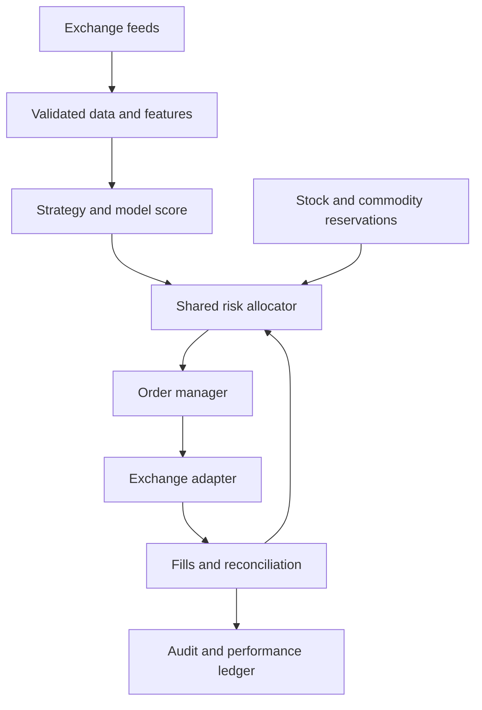

# Crypto trading track — coding-agent addendum

Research checked: 6 November 2026. Status: implementation specification and research plan; no crypto strategy performance or live-account eligibility has been established.

## 1. Scope and preservation contract

Inspection of the existing brief found that `markets_and_brokers.md` explicitly excludes crypto from v1. This document supplies a separate crypto track. It supplements the existing instructions without changing stock behavior.

**Do not edit, append to, regenerate, replace, or republish any existing production Markdown file.** Protected files are `README.md`, `instructions.md`, `architecture.md`, `strategy_and_profitability.md`, `markets_and_brokers.md`, `risk_and_validation.md`, `implementation_roadmap.md`, and `repositories_and_sources.md`. Read them as dependencies. Any implementation work belongs in new modules, profiles, tests, and separately reviewed integration changes. Loading this document must not activate a trading process.

Read this file alongside [COMMODITIES_AND_CFD_TRACK.md](COMMODITIES_AND_CFD_TRACK.md). The project has three research tracks:

| Track | Instruments | Execution boundary |
| --- | --- | --- |
| `STOCKS` | Existing equity universe, including any approved mining shares | Existing stock adapter and policy |
| `CRYPTO` | Initially BTC and ETH spot | New exchange adapter, long only, fully paid |
| `COMMODITIES` | Gold, silver and later commodity exposures | Product-specific adapters; CFDs are one possible route |

CFDs are a product type, not a fourth independent capital pool. A crypto CFD belongs to the crypto economic track but requires a separately certified CFD implementation. A mining share remains an equity instrument even when researched as a commodity exposure. Assign each position one execution owner and one P&L owner; additional analytical tags do not create another position.

Inherit the existing architecture, accounting, evidence standards and numeric risk limits. Asset type and calendar assumptions may differ only inside explicitly named new profiles. The stock profile retains its original restrictions. If a new instrument cannot satisfy a shared risk limit, return `NO_TRADE` and explain the blocker.

## 2. Initial universe and venue decision

Start research with **BTC/EUR and ETH/EUR spot**, subject to the actual account's currency and market permissions. BTC/USD and ETH/USD are alternatives for a funded, eligible USD account; do not convert money merely to match a symbol. Resolve current REST and WebSocket identifiers through venue metadata rather than assuming symbol strings are interchangeable. [C1]

Kraken is the first adapter candidate; Coinbase Advanced is an alternative. These are integration candidates, not claims about the cheapest or most suitable account. Carry forward the original brief's provisional Germany-resident retail assumption and verify it before deployment. Residence, contracting entity, product permissions, funding charges, tax reporting and available APIs remain account-specific. Spot authorization does not establish derivatives permission. Kraken's German-client notice describes its MiCA-related spot arrangements; do not extrapolate it to every crypto product. [C2]

Initial exclusions: borrowing, margin spot, perpetuals, futures, options, staking, lending, liquidity pools, DEX execution, bridges, memecoins, newly listed tokens and automated token discovery. Do not select USDT by default; confirm regional availability and the exact quote asset. Stablecoins require depeg and issuer-risk treatment and must not be marked as guaranteed fiat cash.

No scraping of a web trading interface is an execution adapter. No repository example or public API key is a substitute for account permission.

## 3. One portfolio and one capital allocator

**USD 50 is the total project trading capital, not USD 50 per track or per venue.** There is no required three-way split. Develop all three tracks in parallel in replay/shadow, but permit at most one live track during the initial pilot. Transfers between accounts remain owner-controlled; the bot must not deposit, withdraw or sweep funds.

Separate counterfactual backtests may each start at USD 50 to compare strategies. Label them as alternatives and never sum their balances or profits into a fictitious combined portfolio. A portfolio simulation must use a shared cash ledger and actual venue-specific allocations.

The original `risk_and_validation.md` remains the numeric authority. Initial translations, shown for clarity rather than as a second editable policy, are:

| Shared constraint | At USD 50 |
| --- | --- |
| Planned risk per trade: 0.25% | USD 0.125, including estimated round-trip costs and gap allowance |
| Aggregate planned risk: 0.50% | USD 0.25, including pending entries |
| Symbol exposure: 20%; gross exposure: 40% | USD 10 per symbol; USD 20 total notional |
| Cash reserve: greater of 60% and USD 30 | USD 30 plus separate reservations for known costs |
| Daily loss: 1%; weekly loss: 2.5% | USD 0.50 and USD 1.25 triggers |
| High-water drawdown: 10%; initial-capital pause floor | Pause at the first applicable breach, including equity at/below USD 45 |
| Pilot positions; pending entry orders | One open live position; one pending entry globally |

Keep the existing maximum of two new entries per session, native-protection requirement, quote-age limit of two seconds, account-snapshot limit of five seconds, clock-skew limit of 250 ms, maximum entry spread of 10 bps, and minimum gap allowance of 10 bps. These are ceilings/floors, not proof of an adequate buffer for crypto. Use a larger adverse-fill allowance when evidence requires it; never relax a limit to manufacture eligibility.

For crypto reporting, a session is a UTC calendar day. The portfolio allocator must also track daily/weekly loss continuously across weekends. Define and persist a common 00:00 UTC day boundary and Monday 00:00 UTC week boundary for new portfolio accounting, while retaining every existing stock-account session limit. Both applicable checks must pass. Restarts, venue changes and switching tracks do not reset loss counters.

Use the original effective-equity definition: realized, net, cash-flow-adjusted capital capped by conservative marked equity. Unrealized gains cannot increase sizing. Convert currencies using timestamped, conservative FX quotes; USD reporting does not imply that USD is spendable in a EUR account. Revalue existing risk as prices and FX change.

All writers must reserve capital and risk atomically before submission. Use the existing transactional outbox and account leadership design, with a portfolio reservation ledger covering all accounts. Reading the stock account every few seconds does not prevent simultaneous allocation. If the running stock executor cannot participate, keep new tracks in paper/shadow until either a controlled integration exists or disjoint funds and conservative risk budgets are enforced for every writer. At USD 50, a reconciled handover between single-track pilots is the preferred approach.

## 4. Runtime architecture and contracts

Use the existing Python, Decimal, Pydantic, PostgreSQL and Parquet/DuckDB stack. Avoid a second independent trading framework owning the same account.



Add isolated interfaces, adapting names to the actual repository:

| Contract | Required information or behavior |
| --- | --- |
| `CryptoInstrumentSpec` | Venue/product IDs, base/quote currencies, spot designation, quantity and price increments, minimum quantity/notional, market status, fee currency, certified order capabilities |
| `MarketEvent` | Exchange event time, local receive time, sequence/checksum where supplied, source, instrument, bid/ask or trade/bar payload, validity flags |
| `TradeIntent` | Track, strategy/model version, completed-bar timestamp, side, maximum acceptable entry price, stop policy, expiry, cost estimate and reason |
| `RiskReservation` | Portfolio/account IDs, cash currency, reserved fees/notional/planned loss, policy hash, expiry and state |
| `OrderRecord` | Internal intent ID, client reference if supported, venue order ID, fills, cumulative quantities, fee assets, protection status and reconciliation evidence |
| `DecisionRecord` | Accepted/rejected reason, immutable input snapshot IDs, model output, projected costs and resulting limits |

Normalize these fields internally; do not pretend they are identical across exchange APIs. Quantity and money use Decimal. Retain raw messages for audit without secrets. Exactly one component may submit or replace orders for an account.

Deployment modes are `replay`, `shadow`, `paper` and separately enabled `live`. Shadow only records decisions; paper simulates or uses an approved test environment. Default new modules to disabled with no live credentials. A model can rank candidates or abstain; it cannot submit orders, raise limits, change its allowlist or modify accounting.

## 5. Data and AI research

Start with completed **15-minute bars and one-hour context** for this track; leave the original stock cadence unchanged. Monitor orders and protection continuously, independent of signal cadence. Record venue-specific bid/ask data to estimate achievable fills, including weekends and outages.

Kraken's recent OHLC endpoint returns at most 720 entries and includes an unfinished final candle. It is not a full historical backfill service. Exclude incomplete candles and use appropriately licensed historical archives plus ongoing capture. Kraken provides downloadable OHLCVT archives; inspect gaps and provenance before use. Distinguish a no-trade interval from missing data, and do not fabricate executable liquidity. [C3–C4]

Candidate features: lagged returns, trend slope, realized volatility, ATR, distance from a rolling reference price, volume surprises, spread, time-of-week and BTC market context for ETH. Order-book features are optional only when historical depth and live depth have matching semantics. Record when each input became available. Do not join news, revised datasets or completed higher-timeframe bars before their actual availability.

Test two hypotheses separately:

1. **Trend continuation:** a predeclared trend/regime filter, entry after a pullback or breakout on a completed bar, volatility-based protective stop and bounded holding horizon.
2. **Mean reversion:** a predeclared deviation signal in a non-trending regime, spread/volatility filters and a time exit if convergence does not occur.

Freeze exact windows, thresholds, stop placement, time exit and parameter-search budget before the final evaluation. An illustrative maximum holding period is six hours; it is a research parameter, not an established optimum. Never combine the best fragments of failed experiments without recording another trial.

Build deterministic baselines first. Then test logistic regression or a small gradient-boosted model as a filter estimating outcomes at the intended horizon. Calibrate on training/validation data; compare net economic outcomes, not just classification accuracy. Use purged chronological walk-forward splits with an embargo appropriate to overlapping labels, a recorded search history, and untouched final data. No random time-series split or online self-promotion.

LLM news extraction can be an offline challenger with source URLs, publication/availability times and reproducible outputs. It stays outside the trade loop and the existing zero paid-LLM trading budget. Retrieved text is untrusted input, never an instruction to the executor.

## 6. Costs and minimum viable trade

Use current account- and pair-specific maker/taker rates for both legs, plus spread, adverse selection, slippage, FX and any applicable platform charges. A marketable limit order can pay taker fees. A maker assumption requires a conservative fill model, including queue uncertainty and missed trades; touching a price is insufficient.

At this research check, Kraken's public Tier 1 spot table showed **0.40% maker and 0.80% taker** before applicable discounts. Illustratively, approximately equal USD 10 entry/exit notionals cost USD 0.16 for two taker fills, already exceeding the USD 0.125 planned-risk budget. A USD 5 round trip costs about USD 0.08 before price loss, spread or slippage. These are arithmetic examples, not quotes or guaranteed account fees. [C5]

Fetch the applicable fee schedule rather than hardcoding that example. Kraken's current AssetPairs documentation says its legacy fee arrays are empty; its trade-volume endpoint supports retrieving fee schedules. Unknown fees mean `NO_TRADE`, not zero fees. [C6–C7]

For spot quantity `q`, price `P`, stop `S`, and quote-to-USD factor `x`, require:

```text
notional_usd(q) = q * P * x
planned_loss_usd(q) = q * abs(P - S) * x
                    + stressed_adverse_fill_usd(q)
                    + round_trip_fees_usd(q)
```

Apply the inherited per-trade and aggregate loss budgets, notional caps, reserve and local spendability checks. Include spread exactly once: either simulate buys at ask/sells at bid or explicitly charge it relative to a mid-price model. Round quantity down, then recompute costs and all minimums. Do not round up to qualify.

Base-asset fees can reduce the quantity available for an exit. Quote-asset fees reduce spendable cash. Fees in another token need a conservative conversion and sufficient inventory; do not buy a fee token automatically. Handle residual dust explicitly in marked equity and reports; repeated dust must not create hidden exposure or oversized closing orders.

The feasibility report must show the smallest legal order, expected all-in round-trip cost, break-even move, loss at the frozen stop, affordable size and reasons for abstention. Higher turnover is not a route to subsidizing fees. Report both trading P&L and total project P&L after hosting, data and model expenses; preserve tax records without assuming a universal tax rate.

## 7. Order safety and continuous operation

Persist intent and reservation before network submission. On timeout, reconcile by supported identifiers, open orders, fills and balances before retrying. If order identity remains unknown, pause new entries. A client reference is not evidence that the venue guarantees idempotency; certify exact behavior. Serialize signed requests where nonce rules require it and budget rate limits for exits and recovery.

A successful API validation is not an executed order. Kraken's qualified-client UAT access requires onboarding; its validation mode does not test real matching. Coinbase Advanced's sandbox uses static mocked responses. Use local replay and streaming paper simulation when an appropriate venue test environment is unavailable; never substitute a small live order for a sandbox. [C8–C9]

Before live promotion, certify entry, partial fill, native protective stop, cancellation, restart recovery and final close at the intended tiny quantity. Kraken's conditional close mechanism creates a secondary order for each primary fill; do not assume it is an atomic two-sided OCO bracket. Account for fee-adjusted sellable size and ensure a time exit cannot race a protective order into an unintended short or rejection. [C10]

A stop is not a guaranteed execution price; a stop-limit can remain unfilled. Preserve valid protective exits when pausing entries. Kraken's `CancelAllOrdersAfter` cancels all client orders when its timer expires. Do not enable it as a generic disconnect safeguard if it would remove protection. Certify its scope or use entry-specific cancellations and independent health monitoring. [C11]

After a market-data sequence gap, discard the affected book, restore a fresh snapshot and reconcile before reuse. On account-stream loss, obtain current orders/fills/balances, then resume only if consistent. Run a 24/7 supervisor, clock checks, durable alerts and process-restart tests. Scheduled maintenance and weekend liquidity require explicit policies; an unattended system cannot rely on an owner being awake to place its first protective exit.

Use dedicated trade-only API keys without withdrawal permissions, secret storage, redacted logs and separate paper/live environments. Never include credentials in prompts or research artifacts.

## 8. Repositories and reuse boundaries

Inspected public repositories are building blocks, not evidence of profitable trading. Pin and review a release before installation; the inspected commits below are provenance, not an automatic production-version selection.

| Repository | Inspected commit | Intended use |
| --- | --- | --- |
| [CCXT](https://github.com/ccxt/ccxt) | `a31f168905acea92c05d20750eda0d7ac350eb70` | MIT-licensed normalization candidate; certify venue-specific protection and precision separately |
| [Freqtrade](https://github.com/freqtrade/freqtrade) | `0789f5d5c3e7649e2b83f82d65ecb2e1381f02ad` | GPL-3.0 research/dry-run reference, including FreqAI; isolate execution ownership and review license obligations before copying/distributing code |

CCXT documents optional builder fees on selected exchanges; disable them where applicable or include them in effective costs. Do not assume every adapter has identical capabilities or fee behavior. FreqAI supports retraining workflows, but this project permits challenger training only; a changed model needs frozen evaluation and controlled promotion. Freqtrade's lookahead analysis is a useful diagnostic, not a complete proof that an experiment is causal. [C12–C14]

Do not operate Freqtrade's live trader and the project's order manager on the same account. Reuse one tested integration layer, keeping research outputs portable and the shared allocator authoritative.

## 9. Deliverables, gates and acceptance tests

Implement in this order, using new files without editing the protected Markdown:

1. **Capability and cost report:** account eligibility unresolved/resolved; exact pair metadata; fee source/time; funding/FX; minimum viable trade; native-protection support. A blocker is an acceptable result.
2. **Data and replay:** causal historical dataset with checksums, venue-matched prices and costs, USD 50 ledger, deterministic baseline and no-trade comparator.
3. **Model challenger:** reproducible training, trial registry, untouched tests, net performance attribution and uncertainty.
4. **Forward paper:** live market input, simulated/account-demo fills clearly labeled, restart and outage recovery, daily statement reconciliation.
5. **Portfolio integration:** concurrent reservation tests across all enabled tracks; proof that existing stock behavior and protected files are unchanged.
6. **Optional live pilot:** only after the original release gates, verified account capabilities and a recorded owner live-enablement decision. No automatic funding or scaling.

Apply the original G2 floor of at least 100 completed out-of-sample trades across 120 sessions, with adequate effective sample size and a selection-aware positive lower confidence bound on net expectancy. For crypto, sessions are distinct UTC days, not arbitrary bar batches. Apply G3's minimum 30 completed forward sessions and 20 paper round trips. Extend when evidence is sparse; frequency and gate counts alone establish no edge. Report cash, buy-and-hold, deterministic and AI-filtered baselines under matched capital/cost assumptions. Portfolio statistics must include inactive days and use a stated annualization convention appropriate to continuous trading.

Essential tests: simultaneous stock/crypto capital requests; base-fee partial fills; insufficient funds after fees; dust below exit minimum; stale FX; unfinished bars; revised timestamps; sequence gaps; duplicate and out-of-order fills; submit timeout with an actual fill; stop/time-exit races; loss-limit persistence over a weekend/restart; minimum size exceeding risk; and a dead-man timer that would cancel protection. Tests must assert economic/accounting outcomes, not merely call the same sizing function twice.

Each report includes realized/unrealized P&L, trading fees by currency, estimated versus realized slippage, drawdown, turnover, average net trade, exposure/time in market, rejected opportunities, operating expenses, policy/model hashes and reconciled balances. More trades or higher win rate is not the release objective; reproducible positive net expectancy within the loss policy is.

## 10. Later crypto derivatives

Perpetuals, futures and crypto CFDs remain a separate research-only phase. They need fresh permissions, mark/index and funding data, contract units, linear/inverse P&L treatment, liquidation/margin models, financing and protection certification. The commodity document's CFD concepts can inform a common adapter, but a successful commodity test cannot certify a crypto contract. Do not use a derivative's smaller margin deposit to bypass the USD 50 capital or gross-notional limits.

## Sources

Primary documentation and repository snapshots were checked for this addendum. Revalidate mutable fees, permissions and API capabilities at implementation and before any live release.

- **C1:** [Kraken API symbols and tickers](https://support.kraken.com/articles/360000920306-api-symbols-and-tickers).
- **C2:** [Kraken overview of changes for German clients](https://support.kraken.com/de-de/articles/overview-of-changes-for-german-clients).
- **C3:** [Kraken recent OHLC endpoint](https://docs.kraken.com/api-reference/market-data/get-ohlc-data).
- **C4:** [Kraken downloadable OHLCVT history](https://support.kraken.com/de/articles/360047124832-downloadable-historical-ohlcvt-open-high-low-close-volume-trades-data).
- **C5:** [Kraken Pro fee schedule](https://www.kraken.com/pro/fees).
- **C6:** [Kraken tradable asset pairs](https://docs.kraken.com/api-reference/market-data/get-tradable-asset-pairs).
- **C7:** [Kraken trade volume and fee schedules](https://docs.kraken.com/api-reference/account-data/get-trade-volume).
- **C8:** [Kraken Advanced API FAQ](https://support.kraken.com/articles/advanced-api-faq).
- **C9:** [Coinbase Advanced Trade sandbox](https://docs.cdp.coinbase.com/coinbase-app/advanced-trade-apis/sandbox).
- **C10:** [Kraken WebSocket v2 add order](https://docs.kraken.com/exchange/api-reference/spot-websocket-v2/add_order).
- **C11:** [Kraken cancel all orders after timeout](https://docs.kraken.com/api-reference/trading/cancel-all-orders-after-x).
- **C12:** [CCXT README at inspected commit](https://github.com/ccxt/ccxt/blob/a31f168905acea92c05d20750eda0d7ac350eb70/README.md).
- **C13:** [Freqtrade README at inspected commit](https://github.com/freqtrade/freqtrade/blob/0789f5d5c3e7649e2b83f82d65ecb2e1381f02ad/README.md) and [FreqAI documentation](https://www.freqtrade.io/en/stable/freqai/).
- **C14:** [Freqtrade lookahead analysis](https://www.freqtrade.io/en/stable/lookahead-analysis/).
