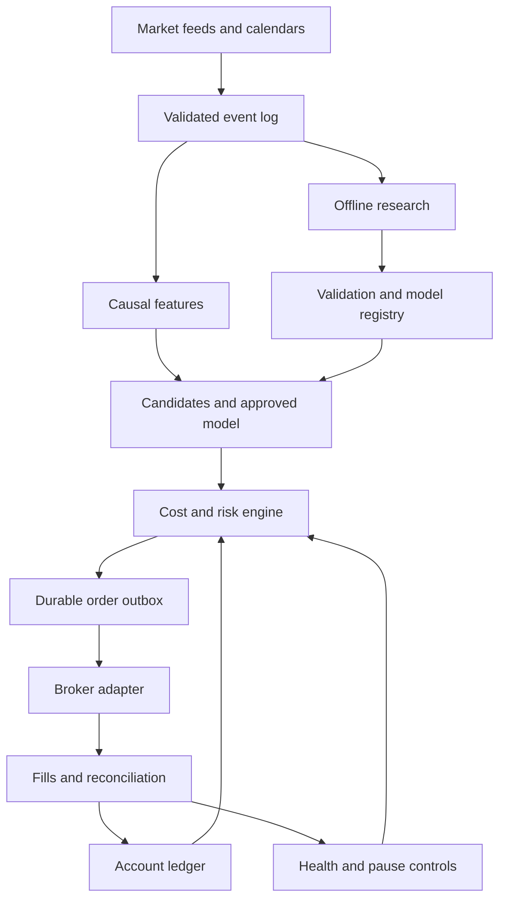
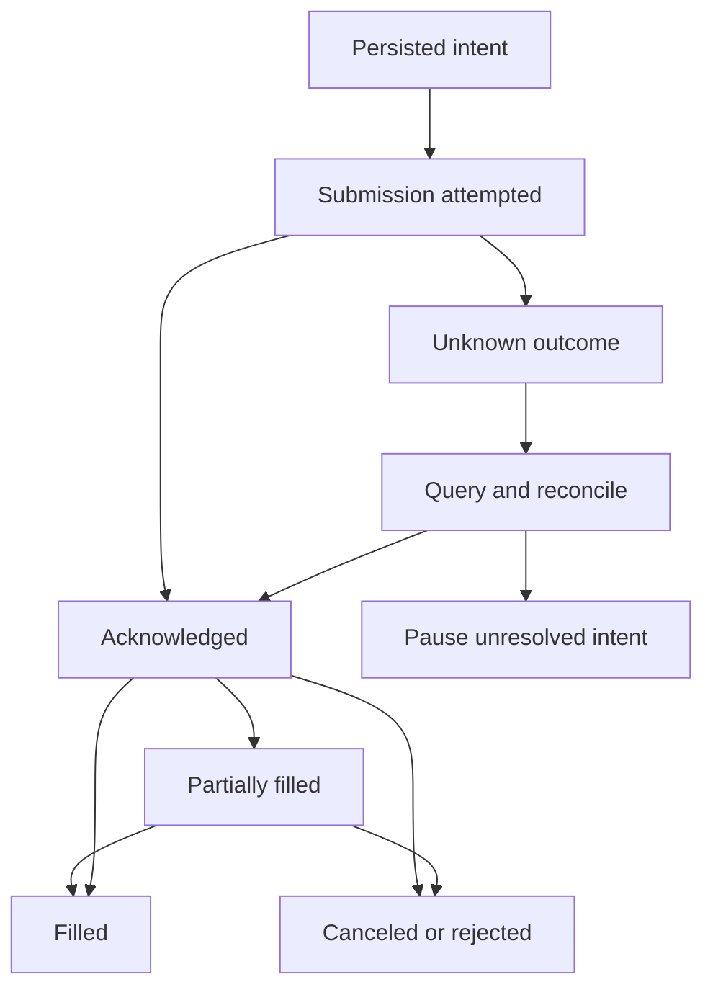

# Architecture and runtime contracts

## 1. System shape

Use a modular Python account worker, a PostgreSQL state store, a separate research process, and optional local read-only monitoring. This keeps the USD 50 pilot operationally small while preserving the boundaries needed for later expansion.



Replay, paper, and live modes share candidate, feature, risk, OMS, and accounting code. Only the clock, event source, broker adapter, and explicitly declared capability profile change. A framework weight target is translated into an intent; it never bypasses USD 50 affordability or broker constraints.

## 2. Authority boundaries

| Component | Can do | Cannot do |
| --- | --- | --- |
| Research agent | Propose bounded experiments, analyze data, write reports | Access live keys, change running policies, submit orders |
| Optional news extractor | Produce timestamped structured annotations | Choose arbitrary symbols or call the broker |
| Approved model | Score predefined candidates and estimate uncertainty | Set borrowing, cash reserves, loss limits, or external transfers |
| Risk engine | Approve/reject exact order plans under a fixed policy | Ignore account restrictions to chase returns |
| Execution worker | Send approved entries and verified reducing exits | Invent an unapproved entry after a timeout |
| Supervisor | Pause entries, reconcile, manage safe recovery | Relaunch into an unresolved position/order discrepancy |

Risk decisions must reference the intent hash, account version, policy hash, model hash, quote timestamp, and expiration. Changing any material input invalidates approval. Keep the broker submit function private to the execution module and test this boundary.

## 3. Domain objects

All objects carry a schema version and UTC timestamps. Instrument identity includes a stable broker asset ID, symbol, venue/MIC where available, currency, security type, and corporate-action lineage. A ticker alone is insufficient across venues or symbol changes.

| Object | Required fields |
| --- | --- |
| `MarketEvent` | Instrument, event/receipt times, sequence or dedup key, feed, bid/ask/trade or bar payload, correction version |
| `Bar` | Start/end/available times, complete flag, OHLCV, feed, adjustment basis |
| `FeatureSnapshot` | Decision time, feature version, values, data watermark, input manifest hash |
| `NewsAnnotation` | Source ID/URL, publication/first-seen times, instrument mapping, structured event category, extractor version, provenance |
| `TradeCandidate` | Strategy ID/version, instrument, direction, intended horizon, entry/exit rule, snapshot hash, expiry |
| `SignalScore` | Candidate ID, model hash, expected gross return, uncertainty, calibrated score, cost estimate |
| `OrderIntent` | Intent/client ID, account ID, instrument, side, exact qty or notional, limit/stop fields, TIF, reason, expiry |
| `ApprovedPlan` | Intent hash, risk decision, policy/account versions, reserved cash/risk, certified exit method, validity window |
| `BrokerOrderEvent` | Broker/client IDs, status, cumulative filled qty, remaining qty, event time, broker sequence/version |
| `Fill` | Unique execution ID, order ID, qty, price, currency, execution/receipt times, fees or fee-pending status |
| `AccountSnapshot` | Equity, settled/unsettled cash by currency, positions, open orders, flags, buying power, restrictions, snapshot time |
| `ModelBundle` | Feature/strategy versions, training cutoff, calibration, thresholds, data hashes, evaluation report, artifact checksum |

Serialize Decimal fields as strings. Reject negative prices, NaNs, unsupported instruments, currency mismatches, malformed quantities, and contradictory broker statuses. Preserve raw sanitized broker payloads for diagnosing adapter errors.

## 4. Broker interface and certification

The following is a proposed interface, not a claim that every upstream API exposes identical methods:

```python
class BrokerAdapter(Protocol):
    def capabilities(self) -> BrokerCapabilities: ...
    async def get_account(self) -> AccountSnapshot: ...
    async def get_positions(self) -> list[Position]: ...
    async def list_orders(self, scope: OrderScope) -> list[BrokerOrder]: ...
    async def get_order_by_client_id(self, client_id: str) -> BrokerOrder | None: ...
    async def submit(self, approved: ApprovedPlan) -> SubmissionResult: ...
    async def cancel(self, broker_order_id: str) -> CancellationResult: ...
    def stream_order_events(self) -> AsyncIterator[BrokerOrderEvent]: ...
```

`BrokerCapabilities` records account legal type, rule regime, fractional instruments/precision, supported order combinations, minimum size, cash availability semantics, native protective orders, sessions, market-data entitlements, rate limits, and fee schedule version.

Use three evidence levels: documented, demonstrated in paper, and confirmed for the intended live account. Paper behavior cannot certify live availability. Unsupported or unknown combinations remain disabled. In particular, fractional limit, stop, stop-limit, bracket/OCO, and extended-hours behavior are separate capabilities.

The adapter must not use withdrawal/funding endpoints. The trading process should receive no funding authority where the broker supports separation.

## 5. Storage and accounting

Runtime tables: `accounts`, `instruments`, `capability_profiles`, `events`, `candidates`, `risk_decisions`, `order_intents`, `submission_outbox`, `broker_orders`, `fills`, `positions`, `cash_lots`, `ledger_entries`, `fee_accruals`, `model_versions`, `pause_state`, and `reconciliation_runs`.

- Unique `(account_id, client_order_id)` and `(broker, account_id, execution_id)` constraints prevent local duplication.
- Persist approved intent, its reservation, and an outbox entry in one transaction.
- Use an account advisory lock plus version/fencing checks to prevent two workers from submitting concurrently. If leadership is uncertain, stop submissions; do not rely on an expired lease alone.
- Cash reservations are not expenses. Release them only after a confirmed reject/cancel or the appropriate filled amount is posted.
- Update position cost basis, fees, realized PnL, and settlement lots from confirmed events. Accrue estimated fees until final charges arrive and then reconcile the difference.
- Keep deposits/withdrawals distinct from trading profit. Currency conversion is a recorded transaction, not a silent PnL adjustment.
- Independently reconcile equity from cash plus marked positions, less fees/liabilities, against the broker. Explain cent-level rounding differences; pause on larger unexplained discrepancies.

For a true cash account, sell proceeds settle on the instrument's calendar and settlement rule. Available buying power is not automatically settled cash. In non-borrowing margin operation, use broker-certified cash availability and the actual rule regime; preserve the legal account type.

## 6. Decision cycle

1. Validate connection, clock skew, session, and broker/account freshness.
2. Apply fills, corrections, corporate actions, and restriction updates.
3. Finalize a completed five-minute bar using its availability time, not just its start timestamp.
4. Build the exact feature version used in training; confirm warmup and feed parity.
5. Generate candidates only from a registered strategy and an eligible allowlisted asset.
6. Score using the currently approved frozen bundle; estimate executable round-trip costs.
7. Require positive conservative net edge, acceptable spread, account permission, available funds, and a certified exit route.
8. Size with Decimal arithmetic; round down to supported quantity precision. Recheck minimum notional and all limits after rounding.
9. Persist the intent, reserve cash/risk, and submit through the outbox worker.
10. Process fills and exit triggers continuously between bar decisions.

Use a continuous stream for health and exits; a five-minute strategy does not mean waiting five minutes to detect a broken connection or a stop trigger. Keep LLM calls out of this cycle. If scoring fails, produce no new entry and continue managing existing positions.

## 7. Order lifecycle and timeout recovery



On an HTTP timeout, the broker may have accepted the order. Persist the unknown outcome and query by client ID, open orders, recent closed orders, and executions. Respect eventual consistency and rate limits. Do not create a new ID to repeat the same trade. Resume submission only after nonacceptance is established under the adapter's certified behavior, the intent is still valid, and risk is reassessed. If acceptance remains ambiguous, freeze new exposure and escalate the unresolved state.

Deduplicate order events and fills. Events may arrive out of order; use execution IDs, cumulative quantities, broker versions, and REST reconciliation. A late fill after a cancel request is a real position and must be managed. “Cancel requested” is not “canceled.”

For cancel/replace, wait for confirmed remaining quantity or use a certified atomic broker replace operation. Prevent overlapping sells from exceeding the owned quantity, including existing protective sells.

## 8. Exits and protective orders

Every entry includes an initial stop rule, maximum holding period, session-close plan, and applicable account permission for selling. For v1, intraday entries stop at 15:30 New York time and the close procedure begins at 15:45, using an exchange calendar for early closes. These are strategy defaults, not fixed Berlin-time offsets.

Prefer broker-held protection when the exact fractional order combination is certified. DAY protective orders expire; verify their coverage through the intended holding window. Never assume a whole-share bracket also protects a fractional residual.

If native protection is unavailable, synthetic exits require continuous monitoring, a second watchdog, and a documented outage scenario. They still cannot protect during a complete system/network failure. Live activation must explicitly resolve this limitation; if the owner requires broker-held protection and it is unavailable, that adapter cannot open positions.

When an entry pause or loss limit triggers: cancel entry orders, account for fills in flight, preserve valid protective exits, and reduce holdings with supported exit orders. A stale quote blocks entries but should not deadlock the exit path; use reconciled position quantities and the broker's certified emergency liquidation method. Halts or a closed market may make immediate exit impossible. Persist the exposure and alert until liquidation is confirmed.

## 9. Recovery, monitoring, and security

On every startup, load pause state and pending submissions, acquire account leadership, fetch positions/open orders/executions, reconcile the ledger, and verify protection. New entries remain disabled until this completes. An unexpected manual position/order is a discrepancy; do not silently absorb it into strategy history.

Monitor quote age, feed gaps, decision latency, clock skew, broker event age, unresolved orders, reconciliation differences, reserves, marked drawdown, model drift, realized fees, and slippage. The first pilot may use a local dashboard and structured logs; paid monitoring is unnecessary. If unattended live operation is later enabled, configure an owner-selected alert channel and test delivery.

Separate paper/live secrets, endpoints, account IDs, and database namespaces. Never log keys. Load secrets from an OS-backed or appropriately restricted secret store. Bind any control interface to localhost initially; authenticate pause/resume actions and record them. LLM prompts contain sanitized data and never account credentials.

Pin artifacts by checksum. Do not deserialize untrusted pickle/model files or enable Qlib's trusted loading options for downloaded artifacts without review. Do not run upstream deployment scripts against a live account to discover their behavior.

## 10. Definition of architecture completion

One recorded session must replay deterministically through the same decision and risk code as paper mode. A crash after broker acceptance but before local acknowledgment must reconcile into one position and one intent, not a duplicate trade. A cash/fee/position discrepancy must produce a persisted pause. The model must be unable to bypass these controls.
